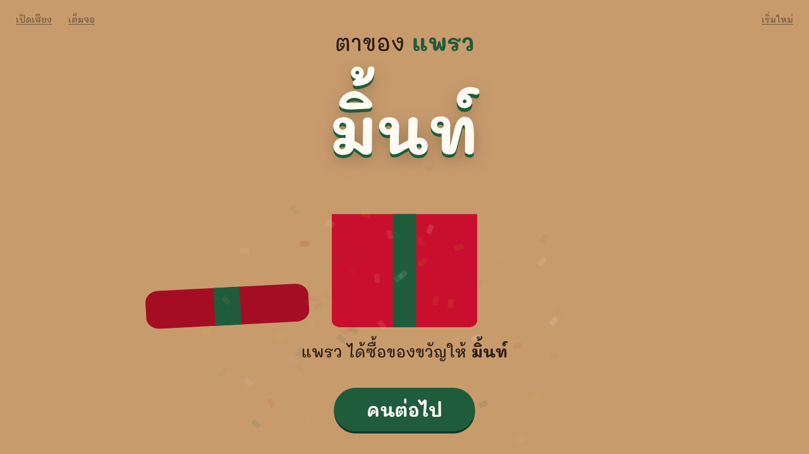

# Who Gifts Who

A gift-exchange name draw for parties, played together on one big screen.

**Live app:** https://puwanarty.github.io/who-gifts-who/



## About

Who Gifts Who runs a gift exchange at a year-end party. The host opens it on a laptop hooked up to a TV, and each guest walks up, taps their own name, and opens a gift box on screen to find out who they are buying a present for. The whole room watches every reveal together.

People who came as a couple never draw their own partner. The interface is in Thai; the steps below give each button's Thai label with an English gloss.

## Features

- **Couple-aware draw.** Nobody draws themselves or their partner, and every valid result is equally likely. If no valid draw exists, the app says so before the party starts.
- **Gift-box reveal.** The box shakes to a drumroll, the lid flies off, and the name pops out with confetti.
- **Built for a TV.** Text and the gift box scale with the screen, from a phone up to a 4K TV.
- **Safe to refresh.** Results are fixed when the draw starts and saved in the browser, so a refresh mid-party changes nothing.
- **Works offline.** After the first visit, the app runs with no internet connection.
- **Party conveniences.** A sound toggle, a fullscreen button, and the screen stays awake while the app is open.
- **Private by design.** There is no server and no account. Names never leave the device.

## How to use

### Before the party

1. Open the app on the device you will use at the party.
2. Press **+ เพิ่มคน** (add person) and type everyone's name. Press Enter in the last name field to add the next row.
3. For each couple, choose the partner under **คู่กับ** (partner). Both sides are linked automatically.
4. Press **เริ่มจับฉลาก** (start the draw).

### During the party

1. The board lists everyone who has not drawn yet. Each guest taps their own name.
2. They press **กดลุ้น** (reveal). The box shakes, opens, and shows who they buy a gift for.
3. Press **คนต่อไป** (next person) to return to the board.
4. When everyone has drawn, a summary lists every pair.

### Screen controls

| Control | Where | What it does |
| --- | --- | --- |
| **ปิดเสียง / เปิดเสียง** (sound off / on) | Top left | Turns the drumroll and reveal sounds off or on. The choice is remembered. |
| **เต็มจอ** (fullscreen) | Top left | Hides the browser bar. Not shown where the browser does not support it, such as Safari on iPhone. |
| **เริ่มใหม่** (start over) | Top right | Clears all results and returns to setup. Names and couples are kept; the next draw is new. |
| **ล้างรายชื่อทั้งหมด** (clear all names) | Bottom of setup | Deletes every name and couple after a confirmation. |

## Tips

- **Use the same device and browser from setup to the end.** Everything is stored in that browser; another device will not see it.
- **Space or Enter works on the reveal screen**, so a keyboard or a presentation clicker can run the show.
- **Keep the app in one tab.** Two open tabs overwrite each other's data.
- **Clear the names afterwards** if you borrowed someone else's laptop.

## Development

Built with [Vite](https://vite.dev/), [React](https://react.dev/), TypeScript, and [Motion](https://motion.dev/). The font is [Mali](https://fonts.google.com/specimen/Mali), bundled with the app. Sounds are synthesized with the Web Audio API, so there are no audio files.

Developed and deployed with Node.js 22.

```sh
npm install
npm run dev        # start the dev server
npm test           # run the tests
npm run typecheck  # type-check
npm run lint       # lint with oxlint
npm run build      # build into dist/
```

## Deployment

Every push to `main` runs [the deploy workflow](.github/workflows/deploy.yml): it tests, builds, and publishes to GitHub Pages.

To host your own copy:

1. Fork the repository. If you rename it, change `base` in [`vite.config.ts`](vite.config.ts) to `/<your-repo-name>/`.
2. Update the absolute URLs in the link-preview tags in [`index.html`](index.html) (`og:url` and `og:image`).
3. In the repository's **Settings → Pages**, set **Source** to **GitHub Actions**.
4. Push to `main`.

## License

[MIT](LICENSE)
